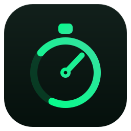
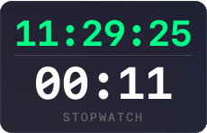

# TimeHUD

A lightweight, transparent HUD overlay for Linux (X11) that shows a system clock
and a stopwatch / countdown / interval timer above fullscreen apps (YouTube,
Netflix, etc.). Written in Rust: the overlay is software-rendered straight onto
an X11 window, so it starts instantly and idles at ~0% CPU.

<p align="center">
  
</p>

---

## Build and install

Requires a Rust toolchain (edition 2024) and the X11 / ALSA / fontconfig / GL
development libraries (Debian/Ubuntu: `build-essential pkg-config libx11-dev
libxcb1-dev libxkbcommon-dev libasound2-dev libfontconfig1-dev
libgl1-mesa-dev`).

```bash
./install.sh            # cargo build --release, installs to ~/.local
PREFIX=/usr/local ./install.sh   # alternative prefix (default: $HOME/.local)
timehud                 # or: timehud --position bottom-right
```

`install.sh` puts the binary in `$PREFIX/bin/timehud`, the icon in
`$PREFIX/share/icons/hicolor/scalable/apps/` and a desktop entry (with an
absolute `Exec=`) in `$PREFIX/share/applications/`.

From a checkout without installing: `cargo run --release`.

Arch Linux: `cd packaging/aur && makepkg -si` (builds from source; the `url` /
`source` fields are placeholders until the repo has a remote).

---

## Command line

| Command | Action |
|---------|--------|
| `timehud` | Start the overlay. If one is already running, toggles its visibility. |
| `timehud toggle` | Start / pause the running timer |
| `timehud reset` | Reset the running timer |
| `timehud show` / `hide` | Show / hide the overlay |
| `timehud quit` | Quit the running instance |

The subcommands exit non-zero with `TimeHUD is not running` when there is no
instance. Flags: `--position <preset>`, `--reset-config`, `--no-tray`,
`--wayland` (ignored, see below), `--version`.

Binding keys in AwesomeWM (`rc.lua`) is the recommended alternative to the
built-in global hotkeys, since it never steals a key combination from other apps:

```lua
awful.key({ modkey, "Control" }, "space", function() awful.spawn("timehud toggle") end,
          { description = "timehud start/pause", group = "timehud" }),
awful.key({ modkey, "Control" }, "r",     function() awful.spawn("timehud reset") end,
          { description = "timehud reset", group = "timehud" }),
awful.key({ modkey, "Control" }, "h",     function() awful.spawn("timehud") end,
          { description = "timehud show/hide", group = "timehud" }),
```

---

## Controls

### Overlay buttons

| Button | Action |
|--------|--------|
| ▶ / ⏸ | Start / pause timer |
| ↺      | Reset timer to zero |
| SW/CD/IV  | Toggle Stopwatch ↔ Countdown ↔ Interval mode |

### Mouse interactions
*You can also interact directly by clicking on the timer numbers:*

| Action | Result |
|--------|--------|
| Single click | Start / pause timer |
| Double click | Reset timer to zero |
| Scroll wheel on timer or mode label | Toggle Stopwatch ↔ Countdown ↔ Interval mode |
| Scroll wheel on the clock | Change font size |
| Scroll wheel on the right of the countdown mode label | Adjust countdown duration (±1 min, far right ±1 s) |
| Drag | Move the overlay (position is saved) |

### Right-click context menu

- **Settings** – full settings window (a separate process, so the overlay stays
  light and interactive)
- **Presets** – one-click countdown, interval (work/rest for a total time,
  e.g. 45/15 for 10 min) and stopwatch (work/rest cycles counting upward
  forever) presets; save the current countdown as a preset or manage them in
  Settings
- **Theme** – switch between built-in looks
- **Click-Through** – toggle mouse pass-through
- **Opacity** – quick opacity change
- **Position** – snap to screen corner
- **Quit**

### Keyboard shortcuts (overlay window focused)

| Key | Action |
|-----|--------|
| Space | Start / pause timer |
| R | Reset timer |
| Escape | Hide overlay |
| Ctrl+Q | Quit |

### Global hotkeys (off by default)

No global hotkey is bound until you set one in Settings → Hotkeys (the fields
suggest `Ctrl+Shift+Space` start/pause, `Ctrl+Shift+R` reset, `Ctrl+Shift+H`
show/hide).

> **Warning:** these are exclusive X11 key grabs. While TimeHUD is running, a
> grabbed combination no longer reaches any other application. If a combo is
> already taken, Settings shows an error and nothing is grabbed. Prefer the
> `timehud toggle` subcommands bound in your window manager if in doubt.

---

## Settings

Right-click → **Settings** or edit `~/.config/timehud/config.json`
(`$XDG_CONFIG_HOME/timehud/config.json`). The file is compatible with the
Python version of TimeHUD in both directions; unknown keys are preserved.

```json
{
  "position": "top-right",
  "custom_x": -1,
  "custom_y": -1,
  "margin": 15,
  "opacity": 0.88,
  "font_size": 30,
  "font_family": "Monospace",
  "color_bg": "#000000",
  "color_clock": "#00FF88",
  "color_timer_run": "#FFFFFF",
  "color_timer_pause": "#888888",
  "show_clock": true,
  "show_timer": true,
  "timer_mode": "stopwatch",
  "countdown_duration": 300,
  "interval_work": 40,
  "interval_rest": 20,
  "interval_rounds": 8,
  "stopwatch_work": 0,
  "stopwatch_rest": 0,
  "phase_beeps": true,
  "halfway_beep": false,
  "sound_enabled": true,
  "sound_interval": 60,
  "sound_alert_before": 0,
  "sound_file": "",
  "show_tray_icon": true,
  "show_controls": true,
  "click_through": false,
  "auto_restart_countdown": false,
  "alert_last_5_seconds": false,
  "presets": [
    { "name": "1 min", "duration": 60 },
    { "name": "5 min", "duration": 300 }
  ],
  "active_preset": "",
  "theme": "classic",
  "progress_style": "line",
  "padding": 12,
  "padding_top": -1,
  "row_spacing": 6,
  "clock_format": "24h",
  "hotkey_toggle": "",
  "hotkey_reset": "",
  "hotkey_visibility": "",
  "notify_on_finish": false
}
```

`custom_x` / `custom_y` of `-1` mean "use `position`"; `padding_top` of `-1`
means "same as `padding`"; `progress_style` is `line`, `border` or `off`.

### Position presets

`top-left` · `top-right` · `bottom-left` · `bottom-right` · `top-center` · `bottom-center`

You can also drag the overlay anywhere; the position is saved automatically.

### Themes

Right-click → **Theme** (or Settings → Display): `Classic` (default),
`Terminal`, `Glass`, `Mono`, `Nord`, `Amber`. Picking a theme sets the color
defaults; you can still customize individual colors afterwards in Settings.

### Sound

Set `sound_interval` (seconds) and `sound_enabled: true`. Leave `sound_file`
empty to use the built-in 880 Hz beep, or point it to any `.wav` / `.mp3` /
`.ogg` / `.flac` file. Sound plays in-process (no external player needed); the
audio device is opened on demand and released after ~10 s of silence. If no
audio device can be opened, TimeHUD falls back to `paplay`, `aplay`, `ffplay`
or `mpv` if one is installed.

If `alert_last_5_seconds` is enabled, the timer plays short beeps at 5, 4, 3,
2 and 1 seconds remaining and a long beep at 0; the timer text also flashes its
warning color on those seconds.

### Interval mode

Work/rest rounds for training (default 40 s work / 20 s rest × 8 rounds,
configurable in Settings → Timer). The round counter shows `WORK 3/8` /
`REST 3/8`, rest phases tint the timer blue, and a thin progress bar under
the timer depletes through each phase. A long beep marks every phase end
(`phase_beeps`), and an optional fast double beep (`halfway_beep`) fires at
half of each work phase; the session ends after the last work phase.

---

## Footprint

Release build, default config, paused stopwatch, clock visible, tray disabled,
measured on the development machine (X11, picom). Rust: `TIMEHUD_TRACE=1`
startup log, `VmRSS` after 10 s, CPU from `/proc/<pid>/stat` over 60 s (both apps
redraw the clock once a second, hence ~0.2 % rather than exactly 0). Python
0.8.1 (PyQt6) measured the same way for RSS and CPU.

| | Rust (0.9.0) | Python (0.8.1) |
|---|---|---|
| Launch to first frame | ~25 ms (24.6 to 27.2 over 4 runs) | not measured |
| Idle RSS after 10 s | 16 MB | 69 MB |
| CPU while paused (60 s) | ~0.2 % | ~0.2 % |

---

## Wayland note

TimeHUD always runs as an **X11 client** (under XWayland on a Wayland session),
which is what makes reliable always-on-top behaviour above fullscreen apps
possible. `--wayland` is accepted for compatibility, prints a warning and is
otherwise ignored.

---

## Packaging and CI

- `packaging/aur/PKGBUILD` – source build for Arch (`makepkg -si`).
- `.github/workflows/ci.yml` – `cargo fmt --check`, `cargo clippy -D warnings`,
  `cargo test` on GitHub and a self-hosted Gitea runner.
- `.github/workflows/release.yml` – pushing a `v*` tag builds
  `timehud-<tag>-x86_64.tar.gz` (binary, icon, desktop file, README, LICENSE)
  and publishes a release on whichever host ran the workflow.

The bundled font (JetBrains Mono Bold) is under the SIL OFL, see `assets/OFL.txt`.
TimeHUD itself is MIT licensed, see `LICENSE`.
